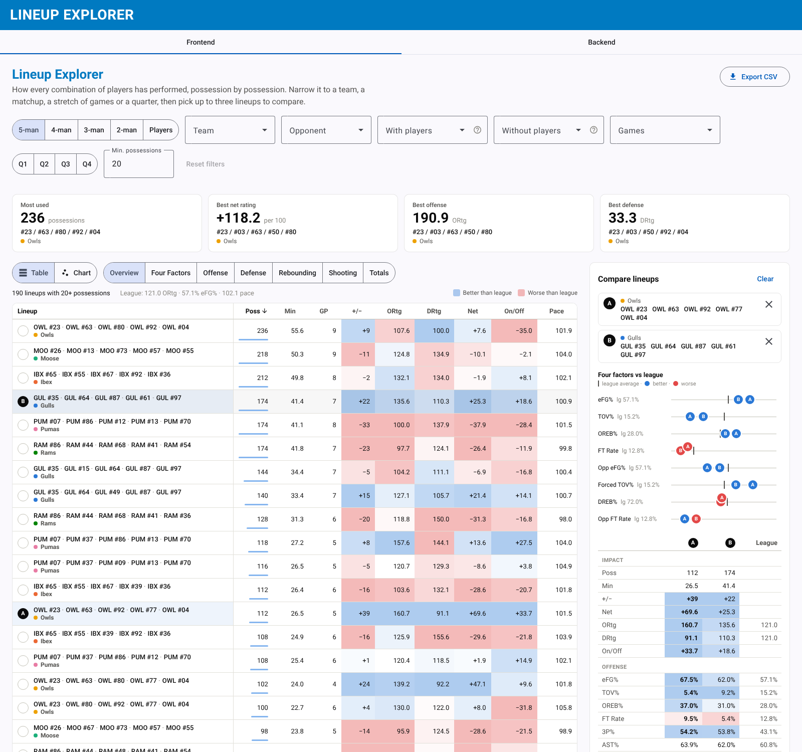

# Lineup Explorer

A tool for coaches and front offices to see which basketball lineups work. A Django REST API aggregates possession-level data into stats for every 1- to 5-man lineup, and an Angular app turns them into a sortable, filterable explorer with comparisons, charts and on/off splits.



More views are in [`screenshots/`](screenshots): the offense vs. defense chart, rebounding table and chart, player on/off, the phone layout and the raw API inspector.

## What it does

**Backend** (Django + Django REST Framework + pandas, PostgreSQL)

* Credits every possession to each n-man combination of the players on the floor, on both offense and defense, so a lineup's totals are every possession that group shared the court.
* Adds metrics on top of the raw sums: offensive, defensive and net rating per 100 possessions, plus-minus, pace, eFG%, TS%, turnover %, free-throw rate, three-point attempt rate, assist %, steal and block rates, and offensive, defensive and total rebound %. Rates with no denominator come back as `null` rather than 0.
* On/off for every lineup: the team's net rating with that group on the floor versus all of the team's other possessions. With lineup size 1 this is a player's on/off.
* Filters for team, opponent, players included, players excluded (for either team), games, periods and minimum possessions, plus sort, order and limit. Bad input returns a clear 400, and ties always sort the same way.

| Endpoint | Returns |
|---|---|
| `GET /api/v1/lineups` | Lineup summaries. Params: `lineup_size` (1-5, default 5), `team_id`, `opponent_team_id`, `player_ids`, `without_player_ids`, `game_ids`, `periods`, `min_possessions`, `sort_by`, `order`, `limit` |
| `GET /api/v1/lineups/baselines` | League and per-team averages for the same possession filters |
| `GET /api/v1/league` | Teams with their players, games and periods to filter by |

**Frontend** (Angular)

* Filters stored as signals, with stale requests cancelled and the current view saved in the URL so it can be shared.
* Cards for the best lineups, and a sortable table shaded against league average with column presets (Overview, Four Factors, Offense, Defense, Rebounding).
* Side-by-side comparison of up to three lineups, CSV export, and loading, empty and error states. It works on a phone.
* A plain-SVG scatter chart (offense vs. defense, shooting, rebounding, turnovers) with dots sized by possessions, colored by team, league-average reference lines, and click-to-compare.
* One file (`frontend/src/app/lineups-summary/lineup-metrics.ts`) defines every metric's label, format and whether higher is better, and drives the table, comparisons, charts and CSV.

## Data

`backend/raw_data/` holds a **simulated six-team league** (Gulls, Pumas, Ibex, Moose, Owls, Rams): 54 players named by team code and jersey number (e.g. `OWL #03`), 30 games and 5,510 possessions. Each player has hidden offensive, defensive and rebounding skill, and possessions are simulated from the ten players on the floor, so the true answer to "who is actually good?" is known. [`analysis/findings.md`](analysis/findings.md) uses the explorer to pick the best lineup, the best player and a counter to a rebounding-heavy opponent, and checks those picks against the simulated truth.

## Run it locally

### 1. Database (PostgreSQL)

```bash
createuser lineups --createdb
createdb lineups -O lineups
psql lineups
```

```sql
-- in the psql lineups shell
create schema app;
alter user lineups with password 'lineups';
grant all on schema app to lineups;
```

Set `DATABASE_URL` to use a different database; the app keeps its `app` schema search path either way.

### 2. Backend (Python 3.12)

```bash
python -m venv .venv && source .venv/bin/activate
pip install -r backend/requirements.txt

cd backend
python manage.py migrate
PYTHONPATH=. python scripts/ingest_raw_data.py   # load raw_data/*.json
python manage.py test app                        # 25 tests, including a brute-force recount of the raw data
python manage.py runserver                       # http://localhost:8000
```

### 3. Frontend (Node 22)

```bash
cd frontend
npm install
npm start   # http://localhost:4200
```

The **Frontend** tab is the explorer; the **Backend** tab shows the raw API response for inspection.

## Deploy

`backend/railway.json` and `frontend/railway.json` hold build and start commands for Railway: the backend runs migrations, collects static files and serves with gunicorn, and the frontend is served by a small Express server (`frontend/server.js`) so shared deep links don't 404. Set `DATABASE_URL` and `DJANGO_SECRET_KEY` on the backend service, and put the backend's public URL in `frontend/src/environments/environment.prod.ts`.

## More

* [`analysis/findings.md`](analysis/findings.md): best lineup, best player (including an adjusted plus-minus model) and a counter to a glass-crashing team.
